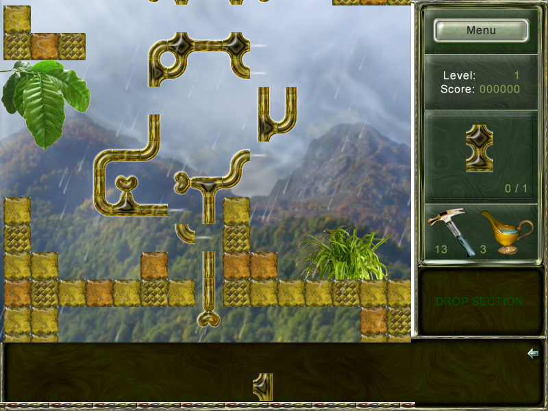
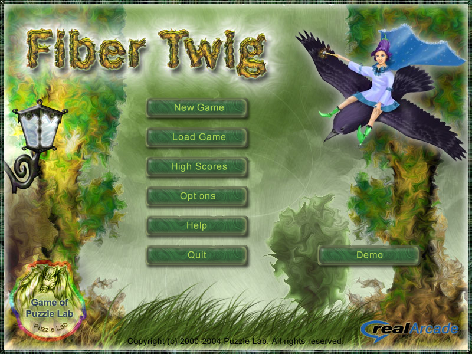
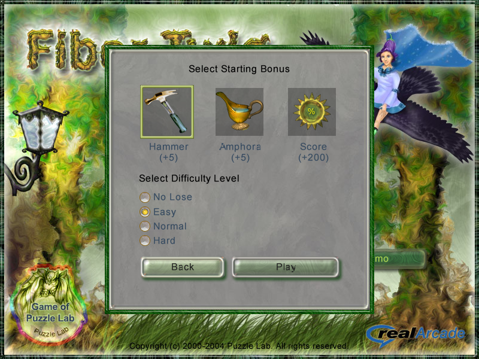
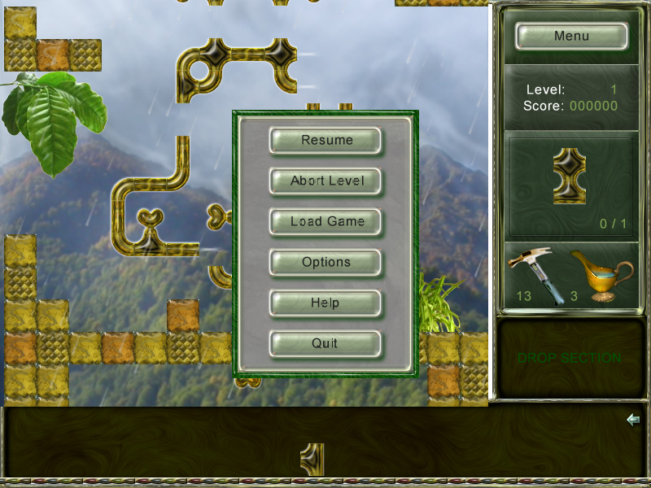
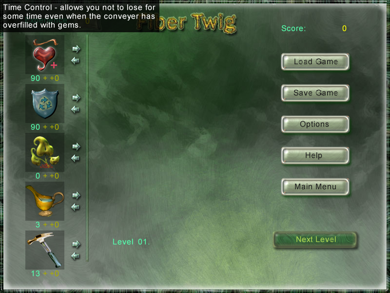
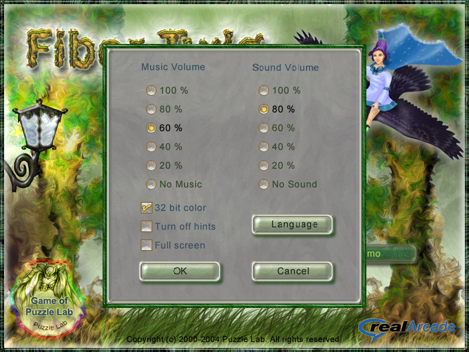
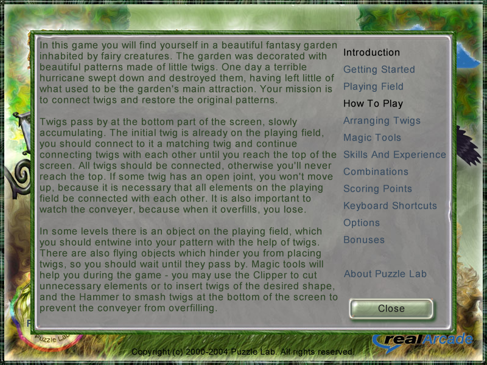
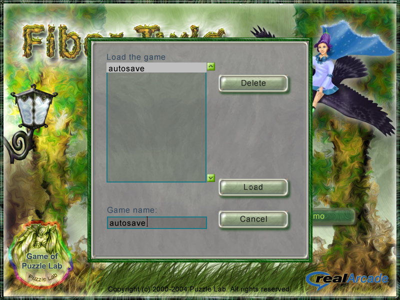
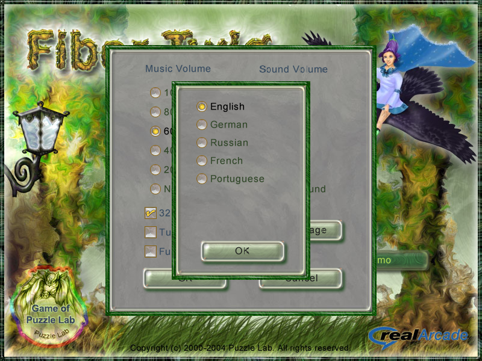
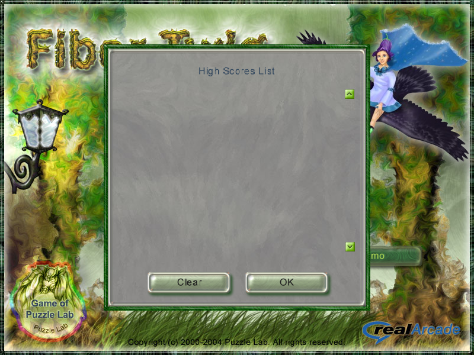

# Fiber Twig — Remake (Godot 4)

A faithful, playable recreation of Puzzle Lab's 2004 puzzle game **Fiber Twig**,
built with [Godot 4](https://godotengine.org/) from the *original* art, audio,
level data and interface definition recovered by reverse engineering the
shipped RealArcade release (see [`../REVERSE_ENGINEERING.md`](../REVERSE_ENGINEERING.md)).



## What is implemented

**Screens** — every screen is drawn from the original `FiberTwig.li` widget
tree (`assets/data/interface.json`) with the original backgrounds
(`Title1.jpg`, `GamePlay1.jpg`, `BetwenDialog.jpg`, `W450x450.jpg`,
`W410x210.PNG`, `W230x330.jpg`, `W700x500.jpg`) and the shipped bitmap font
`Arial12lat.png` + metrics from `Arial12.xml`:

* title screen (New Game / Load Game / High Scores / Options / Help / Quit / Demo),
* *Select Starting Bonus* dialog (Hammer +5 / Amphora +5 / Score +200) with the
  four difficulty modes **No Lose / Easy / Normal / Hard**,
* the in-game screen: 600×500 play field, right panel with the Menu button,
  level/score, the current combination preview, hammer/amphora icons and
  counts, the DROP SECTION area and its arrow button,
* pause menu, between-level experience/skill screen
  (Time Control / Drop Section Accelerator / Good Luck / Amphora / Hammer with
  the +/- arrows, the level description tab `TLevelN` and the level's hero
  portrait from `<HeroPicture>`), load/save (with the `TLabGrid` list, its
  `0xC0C0C0` cursor row and the name edit box), options, help, high-score list
  and all confirmation dialogs.

The dialogs follow the `ShowModal / HideModal / ChangeModal / SetProp /
RunMethod` actions stored in the interface file, so the navigation is the
original one (e.g. `Options → Language` stacks the language dialog on top of
the options dialog and returns there). Options keep the two radio groups of
the original (`100…20 %`, `No Music` / `No Sound`); `Cancel` restores the
state from when the dialog was opened and `OK` writes `options.cfg`. The five
languages of `lng/*.lng` are switched at runtime (bitmap font
`Arial12lat.png`/`Arial12cyr.png`, CP1251/CP1252 byte indexing).

**Play mechanics** (all values taken from the original data files or measured
from the shipped screenshots, see §10 of the report):

* 18 original levels; joint bitmask twigs on a 40 px lattice at
  `(40·col+5, 40·row)`, bricks at `(map.x+5+40·col, map.y+40·row)`,
* camera: automatic, exactly as in the original — no mouse scrolling. The
  view may range from the topmost to the bottommost pre-placed twig and starts
  `(level bottom + 40) - 1000`; every placement aims it at the **lowest open
  joint − 80 px**, clamped to that range, with the original accelerate /
  decelerate motion. The executable advances the velocity byte by exactly
  1 px/tick every game tick; measured under Wine its loop runs at ~180
  ticks/s, so the remake simulates the same fixed tick rate (`CAM_HZ`) — the
  original start view pans ~930 px in ~0.33 s instead of the earlier ~2.5 s
  and always reaches the target. Completing the level starts the original
  camera pan,
* the pointer is the original artwork (`MouseCursor.png` by default,
  `hammer1.png` / `cap1.png` while a usable tool is armed and no twig is
  held) applied as a custom cursor with hotspot `(0,0)` — the original draws
  the surface with its top-left at the mouse position, so the OS pointer is
  replaced instead of being drawn on top,
* background "Fone" pictures are screen anchored, decorations are world
  anchored, rain (`RainEffect`) uses the `RainDrop`/`MidRain`/`SmRain` sprites,
* light streaks from every open joint (`Blick1.png`, 4-frame sparkle, stretched
  along the joint),
* conveyor: the original numbers — new twigs enter at x=799, bottom aligned at
  y=585, at most **26** twigs; they travel left at **25 px/s** in the original
  (measured from `demo.dat`), pile up at x≤5 with a 2 px gap and are fed
  automatically every `Generator period` (ms, ×1.5 on Easy). **For playability
  the remake runs the belt at 2× the original speed** (`--beltspeed=N` sets it
  explicitly, `--beltspeed=25` restores the original). The arrow button
  generates one immediately and postpones the next automatic one. Game over
  only when the belt is completely jammed (first twig at the stop, last two
  overlapping, no twig moving) for about **2 s** — the original draws a
  `ProgressOTT` bar while that timer runs,
* drop section: rectangle `(600,400)-(800,500)` (panel below the tools). A held
  twig dropped there is put on the reverse conveyor at (615, `480−h`), slides
  right at twice the belt speed and is removed at x≥795 (`PutFishkaInOtboynik`);
  it can be taken back while it slides. The cooldown between drops is shortened
  by the Drop Section Accelerator,
* placement rules, straight from the executable: the covered cells must be free
  (transparent targets must match their joint mask exactly), every joint that
  meets a neighbour must be answered by the opposite joint, PutAllow
  (`paBorderFish`/`paAll`/`paNearlight` from `options.cfg`) decides whether the
  placement must cover one of the "next" cells of the pattern, and the
  **ClosedLink** rule refuses only a placement that leaves a connected
  component without any open joint while other components still exist (loops
  are legal); a placement that completes the level is always allowed
  (`--closetest` covers the cases),
* multi-cell twigs (`double1/2`, `double1a/2a`, `tripl1…4`, `adouble1/2`,
  `skoba1…4`): the name encodes the joint mask of every covered cell, the
  shipped artwork (40×80 … 80×80) fixes their layout; a shape is picked up,
  rotated, previewed and placed as a whole, keeps its whole artwork on the
  board (the original stores one twig record per piece), and every covered
  cell scores and clears its ghost; hammering/clipping any of its cells
  removes the whole piece (`--piecetest` covers this),
* mystery twigs (`HidenFishkaPicture`, `prob` uses a decimal comma, i.e. 0.1),
  bonus twigs (`FishkaWithBonus`, 0.05, boosted by the Good Luck skill),
  the seven bonuses of `BonusTypes.dat`
  (+2 hammers, bomb, +2 amphoras, +100 points, drop accelerator, all twigs
  lucky, time control),
* scoring from `FishkaScore`, combinations from `FishCombinations.dat` with the
  level's `CombSequence`, the original hint texts (black hint box),
* original sound effects (mapped exactly like the `[PlaySound]` records of
  `EffectsType.dat`) and music: `WTitle` / `WBetweenLevelMenu` play
  `In the lost forest2.mo3`, a level plays its `<PlayMusic>`, the
  finish-level dialog switches to `Be happy!.mo3` and the next menu returns to
  `In the lost forest2.mo3`; save files in the original `*.sav` format
  (bytes shifted by `+0x33`),
* level completion exactly as in the executable (`FUN_004a0538` returning
  true): all twigs form **one** network **and no joint is left open** - a joint
  pointing at an empty cell or at an uncovered transparent twig keeps the level
  unfinished (there is no separate "top row" test; the top of the pattern is
  closed like everything else).

## Running

```bash
./play.sh                               # launcher (from the repository root)
./play.sh --opengl3                     # OpenGL3 compatibility mode
godot --path remake                     # or the bundled engine:
../tools/Godot_v4.7.2-stable_linux.x86_64 --path remake
```

The project works with any Godot 4.x (tested with 4.7). All resources are
loaded directly from the extracted files, so no import step is required.

| flag | meaning |
|---|---|---|
| `--screen=WTitle\|WStartDialog\|WOptions\|WLanguage\|WHelp\|WLoad\|WSave\|WHighScores\|WMenu\|WBetweenLevelMenu\|WGame` | jump to a screen |
| `--level=N` | start at level N (0…17) |
| `--complex` | only generate multi-cell twigs (debug) |
| `--shot=N` | jump into level N with the reference tool counts |
| `--autotest[=N]` | greedy solver, prints the outcome and quits |
| `--wintest`, `--testsound` | win condition / WAV loading checks |
| `--closetest` | placement/lock rule checks (the tutorial session + rings) |
| `--piecetest` | multi-cell piece checks (whole artwork, whole-piece removal) |
| `--filltest[=N]` | fills level N cell by cell and checks the completion rule |
| `--beltspeed=N` | conveyor speed in px/s (default 50 = 2× the original) |

| input | action |
|---|---|
| LMB on a twig (belt, flying or placed) | pick it up / use the selected tool |
| LMB on the play field | place the held twig (original placement rules) |
| RMB | rotate the held twig 90° clockwise; with a tool selected: put it back |
| `1` … `9` | pick the n-th belt twig |
| `Space` | pick the first belt twig (generate one if the belt is empty) |
| `Del` | throw the held twig away |
| LMB on the DROP SECTION area | drop the held twig (reverse conveyor) |
| LMB on the arrow in the drop panel | push a new twig onto the belt |
| `F3` / `F4` or the tool icons | select the hammer / the amphora |
| `Esc` | menu (pause) |

The camera is automatic (original auto-follow); there is no manual scrolling.

## Assets

`assets/` contains material extracted from the original archives
(`game.zxc`, `squares.zxc`) — see `../tools/zxc.py` and
`../tools/decrypt_levels.py`. Music was converted from the BASS `*.mo3`
modules with `openmpt123` and `oggenc`; the damaged WAV headers were rewritten.

## Tests

```bash
# greedy solver on one level, prints the outcome and quits
godot --headless --path remake -- --autotest=0

# jump straight into a screen (used for the screenshots in docs/)
godot --path remake -- --shot=0          # level 1
godot --path remake -- --screen=title    # title / start / between / options /
                                         # help / scores / load / menu / finish
godot --path remake -- --screen=WGame --level=6   # a specific level
godot --path remake -- --screen=WGame --level=6 --complex   # only multi-cell twigs

# validates the placement rules (lock rule, tutorial regression session)
godot --headless --path remake -- --closetest

# checks the win condition directly
godot --headless --path remake -- --wintest

# checks the multi-cell piece bookkeeping (one piece, whole-piece removal)
godot --headless --path remake -- --piecetest

# verifies that all 16 original WAVs load
godot --headless --path remake -- --testsound
```

The self test is a smoke test, not a proof of solvability: it reports how many
twigs it placed, whether the pattern is connected and whether the top row was
reached.

## Known differences

* The trial/registration screens (`WNotEnabled`, trial timer) are not
  reproduced; all 18 levels are available and `Demo` is inert.
* `FragPicN.png` (a runtime generated picture referenced by `<FragPicture>`) is
  not available in the archive; the panel shows the level's first combination
  instead of that blueprint.
* The joint masks of the `skoba` (ring/arch) shapes are derived from the
  artwork, not from the executable (see §10.7 of the report).
* The invalid placement preview is tinted red; the original tint could not be
  measured from the captures.
* The hero portrait is drawn at its native size at the label position (the
  shipped `elf.png` is exactly 120×360); how the original fits the wider
  portraits is unknown.
* Moving `<Picture>` elements (`MovingCurve`) are drawn at their base position.
* The original `ClosedLink` test was recovered from the executable
  (`FUN_004a1130`/`FUN_004a1360`): only a placement that leaves a component
  without open joints (while other components exist) is refused, and the
  finishing placement is always allowed. `--closetest` covers the tutorial
  session and the locked-ring case.
* The camera target of the original is the lowest open-joint cell minus 80 px;
  the exact set of cells excluded from that scan (`DAT_004bae7c`) could not be
  identified, the remake scans all open joints.
* The drop-section cooldown of the original (`_DAT_004baeb4`, shortened by the
  Drop Section Accelerator) is reproduced structurally; its exact base value is
  not recoverable from the pseudo code.

## Screen gallery

All captured from this remake (800×600 client, the original design size):

| | |
|---|---|
|  |  |
|  |  |
|  |  |
|  |  |
|  |  |

Measured difference against the reference captures of the original game
(`assets/*.png` are 1000×783 captures of the 800×600 client at 1.25× plus a
33 px title bar; they are cropped and resampled to 800×600 with
`work/ref/*.png`). Mean absolute RGB difference, normalised to the 765 value
range:

| screen | mean | max |
|---|---|---|
| help | 4.0 (0.52 %) | 217 |
| high scores | 4.8 (0.63 %) | 245 |
| new game (start dialog) | 6.2 (0.81 %) | 243 |
| options | 6.4 (0.84 %) | 233 |
| title | 6.6 (0.87 %) | 235 |
| load game | 8.3 (1.09 %) | 254 |
| language dialog | 5.4 (0.70 %) | 245 |

The remaining error is font rasterisation, JPEG noise in the captures and the
different save list (the reference session had `LEVEL_01…LEVEL_10`, this one
`autosave`; its capture also carries the screenshot tool's overlay). The
captures of the play field differ by the recorded session state (placed twigs,
random rain drops, hints).
